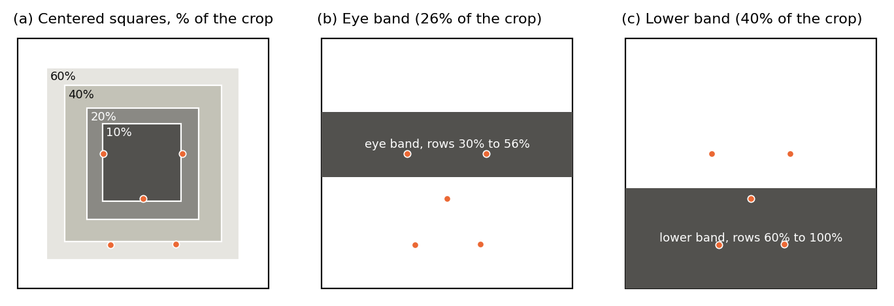
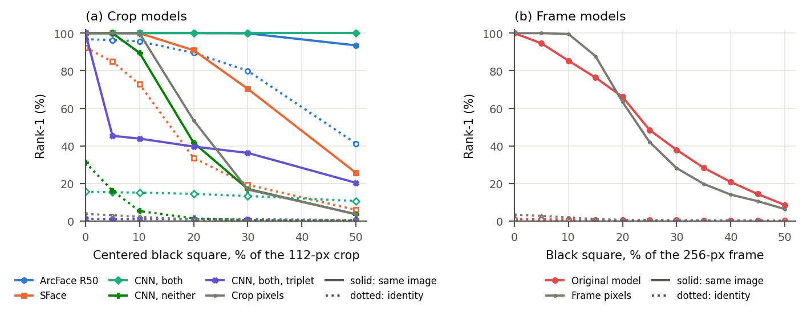
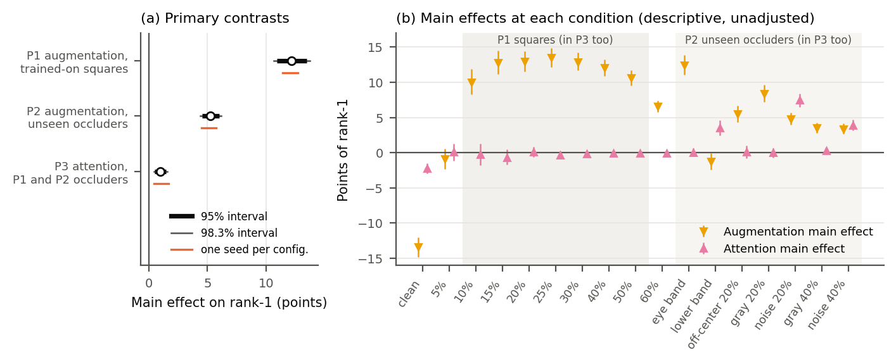

# *Seeing through the mask*

*Final project for CS 6073 Deep Learning, Fall 2025 (original report dated December 4, 2025); Extended November 2026.*

*This chapter describes Ryan Kamp's own version of the course's final project. The team's submitted version was a different code base.*

How well do facial recognition systems work when only *some* of a face is present?

For this Fall 2025 Deep Learning course project, I asked how recognition holds up when part of the face is hidden, and whether a small network with a spatial attention layer, trained on faces with black squares drawn on them, outperforms pretrained recognizers. Originally, the first answer looked dramatic: the small network matched 90% of images with a fifth of the frame covered, while six pretrained models fell to 0 to 6%.

But when returning to the project a year later, I realized that some parts weren't quite right. So, I fixed them. This chapter explains why the 2025 comparison didn't measure what it intended to, and what the cleaner 2026 experiment shows.

## What the original test measured

The original test drew a sample of images and saved them clean, free from occlusion, in a gallery. Each probe was one of the same images with a centered black square on it, and a probe counted as correct if it landed on its own clean copy. That is not identification, which means recognizing a *different* photo of the same person. It is matching an image to itself, and the two images share every pixel the square leaves uncovered.

That task is easy. Matching on raw pixels, with no learning at all, finds 99.2 to 100% of the images when 10% of the frame is covered, across all four sample sizes.

*Figure 1. The original runs, on their own axis: the share of the 256-pixel frame covered. (a) The project's model at each sample size (solid) against matching on raw pixels of the same images (dashed); each sample is one unseeded run. (b) SFace on the 100-image sample: the saved results, an approximate re-creation of the detector path, the same face crop for probe and gallery, and how often the detector finds a face.*

**The project's model beat raw pixels only once the square grew, and by an amount that depended on the sample.** Up to 20% occlusion, raw pixels matched or beat it on three of the four samples; only the 100-image sample showed a lead at 20% (14 points). At 30%, its lead was 6 to 19 points, depending on the sample. Past about 30%, the square covers most of the face (a median 71% of the detected face box at 30%), so what the model still matches may come partly from hair, background, and clothes. That last point is a reading of the coverage numbers; no run tested it.

**For SFace, most of the collapse at small squares came from the face detector.** DeepFace, the library that ran the pretrained models, first looks for a face. In a re-creation on a CPU, its default detector found a face in 95 of 100 clean images, 3 with a 5% square, and 0 at 10%. When it finds nothing, the whole frame is compared with a gallery of mostly face crops, and 74% of the probes at 10% land on one and the same gallery image. Given the same face crop on both sides, and still with the original's matching (Euclidean distance on unnormalized embeddings), SFace matched 84% at 10%, against 2% in the original results. The re-creation is approximate (its version of DeepFace's path gives 11%, not 2%), only SFace was rerun, and VGG-Face held 72% at 5%, so the effect differs by model. In short: for SFace, and likely the others, the collapse at small squares was mostly the detector, not the recognizer.

One more original result doesn't hold up as a finding. With the backgrounds removed, a copy of the project's model fine-tuned on those images matched 56% at 20% (the model matched 90% with backgrounds), while the same model without the fine-tuning matched 68% of the background-removed images at 20%. Raw pixels did *better* without the background, and the same fine-tuning code on the same 50 images gave 24% in one run and 70% in another. With no seed and so few images, the runs vary too much to say why.

## A cleaner experiment

The new study asks the identification question directly, on CelebA-HQ:

- **People the trained networks never saw.** 1,000 test identities, each with one gallery photo and 5,200 probe photos between them. No test identity appears in the trained networks' training data; whether the pretrained models saw any of these celebrities wasn't checked. Picking at random would be right 0.1% of the time.
- **Faces aligned first.** A detector finds the face on the clean image and aligns it to a standard 112×112 crop, and only then is the occluder drawn. That removes the detector problem on purpose, so every accuracy here is likely an upper bound for a real system, whose detector would also have to cope with the occluder.
- **16 synthetic occluders, plus clean faces.** Centered black squares from 5 to 60% of the crop, a band across the eyes, a band across the lower face, a square at a random position, and gray or noise fills.
- **A small ablation.** The project's network, trained on 22,095 crops of 3,516 people, with the attention layer on or off and occlusion training on or off: four configurations, 3 training seeds each, plus a fifth with a different loss. The references are two pretrained models: InsightFace's ArcFace R50 (not the DeepFace ArcFace of the original runs) and SFace.
- **Three main tests.** The study code defines three main comparisons and corrects for testing three things. Everything else, including each single occluder's result, is description.

*Figure 2. Four of the study's centered squares (10, 20, 40, and 60% of the crop) and its two bands, on the 112-pixel aligned crop, drawn on an empty frame with the five landmark positions of the alignment template. No face is shown. The other square sizes, the off-center square, and the gray and noise fills are not drawn.*

All occluders are synthetic, and the dataset is one collection of mostly frontal, high-quality celebrity photos.

## Pretrained models degrade gradually

With the face aligned before it is covered, neither pretrained model collapses at small squares. ArcFace identifies 96.8% of probes clean, 95.7% with 10% of the crop covered, 89.5% at 20%, and 41.3% at 50%. SFace starts at 92.3% and falls faster: 72.8% at 10% and 33.6% at 20%. The coverage percentages here are shares of the crop, not the whole frame, so they can't be set against the original numbers.

*Figure 3. Identity rank-1 against the share of the crop covered, with 95% intervals. (a) The pretrained models with two trained networks and raw pixels. (b) The five trained configurations and raw pixels, on a scale up to 35%.*

**On these occluders, where an occluder sits mattered a lot, even at similar size.** A band across the eyes (26% of the crop) leaves ArcFace at 94.8%, where a centered square of 25% leaves it at 84.3%. A band across the lower face (40%) leaves it at 91.9%, against 63.7% for a 40% square. Bands change the occluder's shape, too, but a randomly placed 20% square also costs less than a centered one: ArcFace identifies 94.8% against 89.5%, and SFace 73.9% against 33.6%. A centered square of that size sits right over the eyes and nose of the aligned face; why place matters this much wasn't tested.

*Live demo on the course site: [Cover the face](https://ryanjosephkamp.github.io/deep-learning-studies/facial-recognition-under-occlusion-project/#cover-the-face). Cover a face the ways the study did, and see the measured rank-1 of each model tested on aligned crops for that occluder.*

**The old protocol flatters every model.** Every model scores higher matching an image to itself than identifying a new photo, at each size run in both tests (up to 50%). The original saved model is the extreme case: it still matches 85.4% of frames to themselves with 10% of the frame covered (about 1 in 30 of them were probably among its training images), but identifies 1.0% of clean probes, below raw pixels of the frame at 3.4%, and 20 of its 54 hits are on the 52 probes most similar to their gallery photo (an ArcFace R50 cosine of at least 0.9). (Every model matches all clean images to themselves, since a clean probe is its own gallery image.) It was trained for image matching, and it identifies poorly.

*Figure 4. Matching the same image (solid) against identifying a new photo (dotted). (a) Crop models, on the crop's axis. (b) The original model and raw frame pixels, on the frame's axis, which is not comparable with (a).*

**Occlusion made both pretrained verifiers refuse the right person more often.** With the acceptance threshold set on clean faces (here, for a 1% false accept rate) and a clean gallery photo, occlusion lowered both pretrained models' false accept rates in this study instead of raising them. At a 50% square, ArcFace's true accept rate falls to 57.3% while its false accept rate falls to 0.36%. What rises is the rate of refusing the right person, not of admitting the wrong one.

*Live demo on the course site: [Does it still know you?](https://ryanjosephkamp.github.io/deep-learning-studies/facial-recognition-under-occlusion-project/#still-know-you). SFace, one of the study's two pretrained models, runs on your device and compares a covered picture of a face, yours if you like, one to one with a clear one.*

## What the project's two ideas do

First, context. The small network trained here identifies only 15.6 to 31.3% of clean probes, against 96.8% for ArcFace, which was trained on a far larger face collection. The point of the ablation is the difference between configurations, not a contest with pretrained models.

**Training with occluded faces is a trade.** Across the centered squares it trained with, occlusion training adds 12.1 points of rank-1 (95% interval +10.9 to +13.4). On the occluders it never saw, it adds 5.2 points on average (+4.5 to +6.0). Both pass the study's decision rule clearly. But it costs 13.4 points on clean faces, and its help on unseen occluders is uneven: +12.4 points on the eye band, +4.8 on a 20% noise fill, and −1.3 on the lower band, where it made rank-1 slightly worse (a descriptive result, not one of the main tests).

That clean cost is measured at one training budget, though. Every network trained for 40 epochs, and the CosFace networks trained with occlusion ended at a training loss that the matching ones without it had passed about halfway through. The two losses aren't directly comparable, since one includes covered faces, but some of the clean cost may come from less training on clean faces. A longer training run of both kinds could test whether the gap shrinks, and none has been made.

*Figure 5. (a) The three main comparisons: estimate, 95% interval (thick), 98.3% interval (thin), and the range over the 81 ways to take one seed per configuration. (b) The augmentation and attention effects at each condition, the clean one included, for description only (unadjusted).*

**The attention layer helps in a narrow way.** Its main comparison, averaged over 14 occluders, was +1.0 point and stayed positive in all 81 ways to take one seed per configuration (95% bootstrap interval +0.5 to +1.5), though with three seeds, whether it is significant depends on the test. It comes from three places: the two noise fills and the lower band (where the gain is in the network trained without occluded faces). On the centered black squares from 10 to 50%, averaged over both training setups, none of the seven per-size estimates had a 95% interval that excluded zero, and with three seeds, that is not proof of no effect; with occlusion training, adding attention even lowered rank-1 by 1.0 to 2.2 points on the 10 to 25% squares (a descriptive result). On clean faces, it costs 2.2 points. The clearest case: with occlusion training, the network *without* attention is at or below chance on rank-1 under noise fills (0.1% and 0.0%), and the one *with* attention keeps 12.6% and 7.4%. Why the network without attention breaks on noise wasn't tested. The attention weights point the same way (near zero inside a noise fill), but they are weak evidence: the triplet runs that failed to train show the same low weight inside occluders, and away from the edges of a flat black square, the layer's input is constant, so its weight there says little.

*Live demo on the course site: [Draw the seeds](https://ryanjosephkamp.github.io/deep-learning-studies/facial-recognition-under-occlusion-project/#seed-draws). Take one training seed per configuration, as the study's 81 draws did, and watch the three main comparisons move.*

**The fifth configuration failed to train.** A version trained with a batch-hard triplet loss didn't train: its loss sat near the margin from the first epoch, and it identifies 1.3% of clean probes. That says only that this particular triplet setup failed here.

## What it adds up to

- The original project asked a good question, and it trained a model that still reproduces its curves at the three sample sizes that were rerun. Its test measured image matching, which raw pixels already do well at small occlusions, but not true identification. In an approximate re-creation for SFace, its collapse at small squares traces mostly to the face detector, and a similar story is likely for the other pretrained models.
- With faces aligned before they are covered, a pretrained ArcFace identifies 89.5% of new photos with 20% of the aligned crop hidden (a different axis from the original's frame). On these occluders, bands and off-center squares cost the pretrained models less than centered squares of similar size.
- In a small network trained from scratch, training on occluded faces buys 12.1 points on the occluder it practiced on and costs 13.4 on clean faces. The attention layer's main comparison comes from noise fills and the lower band, and it costs 2.2 points on clean faces.
- All of this is on one dataset, with synthetic occluders, oracle alignment, and three seeds per configuration. No result is broken down by demographic group, and none shows whether these models are fit for real-world use. Real masks and sunglasses, and a real detector, would be a natural follow-up.

The full paper, with its tables, intervals, and limitations, is `paper/main.tex`. The code, the aggregate results, and how to obtain the data are in this project's folder, and the original model's weights are attached to the repository's release. Known and potential problems found after release are listed in the repository's [KNOWN-ISSUES.md](https://github.com/ryanjosephkamp/deep-learning-studies/blob/main/KNOWN-ISSUES.md).
